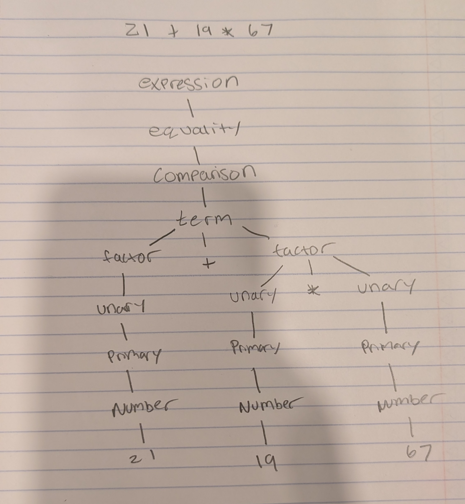

# Lab 3 Report

## Expression Grammar
```
expression -> equality ;
equality -> comparison ( ( "!=" | "==" ) comparison )* ;
comparison -> term ( ( ">" | ">=" | "<" | "<=" ) term )* ;
term -> factor ( ( "-" | "+" ) factor )* ;
factor -> unary ( ( "/" | "*" | "%" ) unary )* ;
unary -> ( "!" | "-" ) unary | primary ;
primary -> NUMBER | STRING | "true" | "false" | "null" | "(" expression ")" ;
```

#### Preceedence Rules (lowest to highest)
- equality `==` `!=`, comparison `>` `>=` `<` `<=`, term `-` `+`, factor `/` `*` `%`, unary `!` `-`

#### Associativity
- All the binary operators are left associative, unary is right associative.

## Design Choices
- Changes since Lab 2
    - My lab 2 grammar was ambiguous (`6 / 7 - 1` could make two trees), so I split it into one rule per precedence level like the slides.
    - `%` went into factor with `*` and `/`
- Errors
    - If the scanner has an error the parser does not run, otherwise 1 + @ would also give a fake syntax error.
    - Anything after the expression is an error, and the extra `)` gets its own message
    - Super deep nesting would crash pythons call stack, so I catch the RecursionError and report it as an error insted. 

## Setup/Dependencies
There are no dependencies. You can run from the repo root. The project uses Python.

## Testing
Test files are in `test/lab3/valid/` and `test/lab3/errors/`.

**All file tests:** `python test/lab3/run_all_tests.py`

**One file:** `python src/nario.py test/lab3/<folder_name>/<test_file>`

**Repl mode:** `python src/nario.py`, the testing lines are in `test/lab3/repl_testing.md`

| Purpose | Source | Expected | Actual Output | Matched Expectations? |
|---|---|---|---|---|
| Test all the comparison operators and make sure they're left associative | comparison.nario | `(>= (<= (> (< 1 2) 3) 4) 5)` | same | Yes |
| Test == and != and make sure they're left associative | equality.nario | `(!= (== 21 67) 21)` | same | Yes |
| Test *, /, and % and make sure they're left associative | factor.nario | `(% (/ (* 21 2) 19) 4)` | same | Yes |
| Test nested parentheses | grouping_nested.nario | `(group (/ (group (- 21 (group (* 9 2)))) (- (group 67))))` | same | Yes |
| Test every literal type | literals.nario | `(== (== (== (== (== (== (== 7 69.42) 670) 0.067) "Nario") true) false) null)` | same | Yes |
| Test an expression split over multiple lines with comments in it | multiline_comments.nario | `(+ 21 19)` | same | Yes |
| Test one operator from every precedence level | precedence.nario | `(== (< (+ (- 1) (* 2 3)) 4) (! false))` | same | Yes |
| Test + and - and make sure they're left associative | term.nario | `(- (+ 67 2026) 21)` | same | Yes |
| Test that unary is right associative | unary_right_assoc.nario | `(! (! (- (- 1))))` | same | Yes |
| Test an extra ) with no ( | extra_right_paren.nario | An error at the extra ) at line 1 col 10 | same | Yes |
| Test a lexical error, the parser shouldn't run | lexical_error.nario | Only the scanner error at line 2 col 5, and no AST | same | Yes |
| Test nothing before the * | missing_left_operand.nario | A missing left operand error at line 1 col 1 | same | Yes |
| Test a missing left operand in the middle | missing_left_operand_middle.nario | A missing left operand error at line 1 col 5 | same | Yes |
| Test a missing ) when the ( is on a different line | missing_paren_multiline.nario | An error at line 2 col 3 that says the ( is at line 1 col 1 | same | Yes |
| Test nothing after the + | missing_right_operand.nario | An error at line 1 col 5 | same | Yes |
| Test a missing ) | missing_right_paren.nario | An error at line 1 col 7 that says where the ( was | same | Yes |
| Test two expressions in one file | trailing_token.nario | An error at the 7 at line 1 col 3 | same | Yes |
| Test Repl mode. And make sure it keeps working even after errors. | repl_testing.md | Each AST and error is shown, and it keeps working after an error | All 10 lines matched and it kept working after each error | Yes |

## Syntax Tree
`21 + 19 * 67` (first line in repl_testing.md)




**Printed AST:** `(+ 21 (* 19 67))`

The printed AST is the same tree but without all the in between rules. Only the rules that matched an operator become nodes. `term` matched the `+` so it's the root, and `factor` matched the `*` so it's on the right side under it. Rules like `equality` and `comparison` didn't match anything, so they just pass the expression up and don't show up in the AST. The `*` is lower than the `+`, so it gets evaluated first.

## Known Limitiation
- Only the first syntax error is repoted 
- No identifiers yet, so `x + 1` is an error
- Nesting a ton of parentheses deep hits pythons recursion limit, it gets reported as an error but is not parsed
- Repl mode is one line at a time, so multi-line expressions only work in file mode

## Extra Credit 
- If primary sees a binary opertor the program will catch that and say the operator is missing its left operand. Before `* 21` just said it was expecting an expression, but now it catches that exactly. `-` is left out since it can be unary. And it also works in the middle of an expression like `1 + * 2`. 
    - Tests: `missing_left_operand.nario`, `missing_left_operand_middle.nario`, and `* 5` in repl mode
